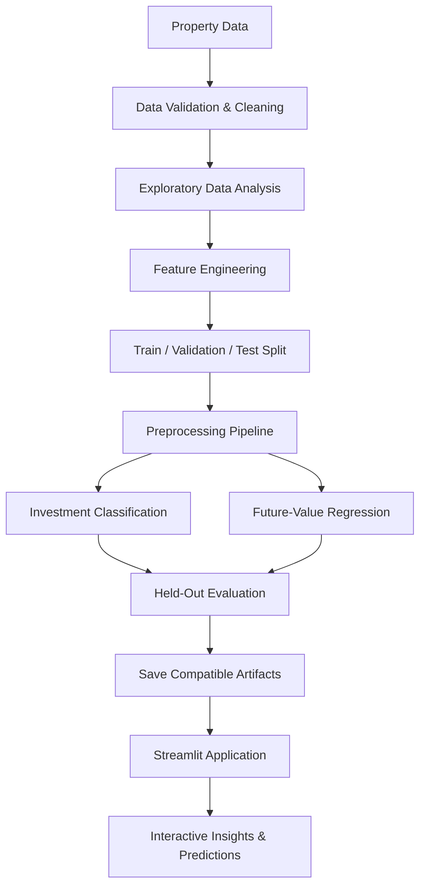

# 🏡 Real Estate Investment Advisor

### Predicting Property Profitability & Future Value

**Turning property data into actionable investment insights with
analytics, machine learning, and interactive visual storytelling.**

[](https://chwtfss6opqw26gupcfu4s.streamlit.app/)
[](https://www.python.org/)
[](https://streamlit.io/)
[](https://plotly.com/python/)
[](https://github.com/)

**[Open the Live
Dashboard](https://chwtfss6opqw26gupcfu4s.streamlit.app/)**
:::

------------------------------------------------------------------------

## 🌟 Project Snapshot

  -----------------------------------------------------------------------
  Focus Area                          What this project aims to deliver
  ----------------------------------- -----------------------------------
  🏘️ Real Estate Analytics            Explore property characteristics,
                                      prices, and market patterns

  🎯 Investment Screening             Use a trained classification model
                                      to assess an investment category,
                                      if implemented

  📈 Future Value                     Estimate future property value
                                      using the project's regression
                                      logic

  🔎 Explainability                   Review influential features and
                                      model outputs where available

  🎛️ Interactive Experience           Explore supported filters, inputs,
                                      comparisons, and what-if scenarios

  🧪 Model Quality                    Evaluate predictions using held-out
                                      data and appropriate metrics
  -----------------------------------------------------------------------

> **Important:** Feature descriptions must match the deployed
> implementation. Predictions are estimates---not guaranteed returns,
> certified valuations, or personalized financial advice.

## 🎯 Business Problem

Property investment decisions depend on multiple variables, including
location, size, property type, asking price, condition, and changing
market conditions. Reviewing these factors manually can make it
difficult to compare properties consistently.

The **Real Estate Investment Advisor** project explores how data
analytics and machine learning can support a structured property
evaluation workflow---from exploratory analysis to model-assisted
decision support.

### Business objectives

-   Understand patterns and variation in property prices.
-   Compare properties using available attributes and market data.
-   Estimate investment classification or future value where supported
    by the trained models.
-   Communicate findings through interactive charts rather than static
    tables alone.
-   Make model limitations and assumptions visible to users.

## ✨ Key Capabilities

### 📊 Interactive Property Analytics

Explore property and market data with visual summaries, filters, and
comparisons available in the app.

### 🎯 Investment Prediction

Use supported property inputs to generate a model prediction. A
predicted class is not a guarantee of profitability.

### 🔮 Future-Value Estimation

Review model-based future value estimates, including the forecast
horizon and assumptions used by the implementation.

### 🧠 Model Evaluation & Explainability

Where implemented, inspect classification metrics, regression errors,
feature importance, and prediction diagnostics.

### 🧪 Experiment Tracking

MLflow can be used to track model experiments and metrics if it is
configured in the project. Keep experiment results reproducible and
document the evaluation data.

------------------------------------------------------------------------

## 📸 Interactive Visual Showcase

**Add genuine screenshots from your live app or local application** to
the `assets/` folder using the filenames below. These slots are
placeholders until the image files exist.

```{=html}
<table>
```
```{=html}
<tr>
```
```{=html}
<td width="50%" valign="top">
```
```{=html}
<h3>
```
🏙️ 01 · Market Overview
```{=html}
</h3>
```
``{=html}
```{=html}
<p>
```
`<strong>`{=html}Recommended visuals`</strong>`{=html}
```{=html}
</p>
```
```{=html}
<ul>
```
```{=html}
<li>
```
KPI cards for verified dataset summaries
```{=html}
</li>
```
```{=html}
<li>
```
Property price distribution
```{=html}
</li>
```
```{=html}
<li>
```
Property-type and location comparisons
```{=html}
</li>
```
```{=html}
</ul>
```
```{=html}
</td>
```
```{=html}
<td width="50%" valign="top">
```
```{=html}
<h3>
```
🎯 02 · Investment Advisor
```{=html}
</h3>
```
``{=html}
```{=html}
<p>
```
`<strong>`{=html}Recommended visuals`</strong>`{=html}
```{=html}
</p>
```
```{=html}
<ul>
```
```{=html}
<li>
```
Property input controls
```{=html}
</li>
```
```{=html}
<li>
```
Predicted investment category
```{=html}
</li>
```
```{=html}
<li>
```
Comparable-property attributes
```{=html}
</li>
```
```{=html}
</ul>
```
```{=html}
</td>
```
```{=html}
</tr>
```
```{=html}
<tr>
```
```{=html}
<td width="50%" valign="top">
```
```{=html}
<h3>
```
📈 03 · Future Value
```{=html}
</h3>
```
``{=html}
```{=html}
<p>
```
`<strong>`{=html}Recommended visuals`</strong>`{=html}
```{=html}
</p>
```
```{=html}
<ul>
```
```{=html}
<li>
```
Actual vs. predicted values
```{=html}
</li>
```
```{=html}
<li>
```
Transparent forecast assumptions
```{=html}
</li>
```
```{=html}
<li>
```
Scenario comparisons
```{=html}
</li>
```
```{=html}
</ul>
```
```{=html}
</td>
```
```{=html}
<td width="50%" valign="top">
```
```{=html}
<h3>
```
🧠 04 · Model Insights
```{=html}
</h3>
```
``{=html}
```{=html}
<p>
```
`<strong>`{=html}Recommended visuals`</strong>`{=html}
```{=html}
</p>
```
```{=html}
<ul>
```
```{=html}
<li>
```
Feature importance
```{=html}
</li>
```
```{=html}
<li>
```
Confusion matrix or regression residuals
```{=html}
</li>
```
```{=html}
<li>
```
Model comparison backed by test results
```{=html}
</li>
```
```{=html}
</ul>
```
```{=html}
</td>
```
```{=html}
</tr>
```
```{=html}
</table>
```
**Screenshot tip:** capture the actual application at a readable browser
width. Remove private information, avoid fake metric values, and remove
any screenshot slot for a feature that is not implemented.

## 📊 Recommended Recruiter-Friendly Visuals

  -----------------------------------------------------------------------
  Dashboard section       Interactive visual      Business question
  ----------------------- ----------------------- -----------------------
  Executive overview      KPI cards, summary      What are the main
                          charts                  patterns in the
                                                  available dataset?

  Market analysis         Histograms, box plots,  How do property prices
                          scatter plots           vary by size, type, or
                                                  location?

  Investment screening    Property input form and What does the model
                          prediction summary      predict for this set of
                                                  inputs?

  Future value            Predicted-value chart   How do forecast
                          and scenario controls   assumptions affect the
                                                  estimate?

  Model evaluation        Confusion matrix,       How reliable are
                          actual-vs-predicted     predictions on unseen
                          chart, residuals        data?

  Explainability          Feature importance or   Which inputs influence
                          supported explanation   model output?
                          method                  
  -----------------------------------------------------------------------

For a polished interface, use consistent typography, clear units,
readable axis labels, helpful hover details, responsive layouts, and
restrained navy/cyan accents. Every chart should answer a business
question.

## 🧠 Machine-Learning Workflow



*This is a reference workflow. Adjust it to match the actual training
notebooks, model artifacts, and deployed application.*

## 🧰 Technology Stack

  -----------------------------------------------------------------------
  Technology                          Purpose
  ----------------------------------- -----------------------------------
  **Python**                          Application logic and machine
                                      learning

  **Pandas / NumPy**                  Data preparation and numerical
                                      analysis

  **Streamlit**                       Interactive web application

  **Plotly**                          Interactive charts and data
                                      exploration

  **Scikit-learn**                    Preprocessing, modelling, and
                                      evaluation where used

  **XGBoost**                         Gradient boosting, if used in the
                                      implementation

  **Joblib**                          Model persistence, if used

  **MLflow**                          Experiment tracking, if configured

  **Git / GitHub**                    Version control and portfolio
                                      documentation
  -----------------------------------------------------------------------

Keep only the technologies used by your actual code and notebooks. Pin
compatible dependency versions in `requirements.txt`.

## 📏 Model Evaluation

Use metrics calculated on a **held-out test set**. Add the actual
results from your experiment or evaluation report---never invent
performance figures.

### Classification metrics

-   Precision, recall, and F1-score
-   Accuracy and confusion matrix
-   ROC-AUC when suitable for the task and class setup

### Regression metrics

-   Mean Absolute Error (MAE)
-   Root Mean Squared Error (RMSE)
-   R² score
-   Actual-vs-predicted plot and residual analysis

### Business interpretation

Explain what the measured errors mean in the target's units. Compare
models on the same split and explain any threshold used to label an
investment as "good." If future values are calculated from a growth
assumption rather than learned from time-based data, disclose that
clearly.

## 🗂️ Suggested Repository Structure

Adapt this structure to the existing project and preserve paths required
by your application.

``` text
real-estate-investment-advisor/
├── app.py
├── Insights.py
├── README.md
├── requirements.txt
├── .gitignore
├── assets/
│   ├── market-overview.png
│   ├── investment-analysis.png
│   ├── future-value.png
│   └── model-explainability.png
├── data/                 # Only share data you are allowed to publish
├── models/               # Required model artifacts, if applicable
├── notebooks/            # EDA, training and evaluation
├── reports/              # Verified metrics and business findings
└── tests/                # Data validation and prediction tests
```

Do not commit credentials, `.env` files, `.streamlit/secrets.toml`,
virtual environments, caches, or unnecessary local databases. If model
artifacts are too large for regular Git, consider Git LFS or an
appropriate artifact store. Ensure the deployed application can access
every required artifact.

## 🚀 Run Locally

### 1. Clone your repository

Replace `YOUR_GITHUB_USERNAME` with your actual GitHub username and
confirm the repository name.

``` bash
git clone https://github.com/YOUR_GITHUB_USERNAME/real-estate-investment-advisor-predicting-property-profitability-future-value.git
cd real-estate-investment-advisor-predicting-property-profitability-future-value
```

### 2. Create a virtual environment

**Windows CMD**

``` bat
python -m venv .venv
.venv\Scripts\activate
```

**macOS / Linux**

``` bash
python3 -m venv .venv
source .venv/bin/activate
```

### 3. Install dependencies

``` bash
python -m pip install --upgrade pip
python -m pip install -r requirements.txt
```

### 4. Launch the application

``` bash
python -m streamlit run app.py
```

If `Insights.py` is designed to run as a standalone Streamlit app,
launch it with:

``` bash
python -m streamlit run Insights.py
```

If it is part of a multipage application or imported module, use the
navigation and launch pattern implemented in your code.

## ☁️ Live Demo

::: {align="center"}
### [🚀 Open the Real Estate Investment Advisor](https://chwtfss6opqw26gupcfu4s.streamlit.app/)

Explore the deployed application and its available analytics and
prediction features.
:::

If you deploy your own version, connect the GitHub repository to
[Streamlit Community Cloud](https://share.streamlit.io/). Verify the
entry-point file, Python version, `requirements.txt`, secrets
configuration, and model paths before sharing the app.

## 🛡️ Data Quality, Limitations & Responsible Use

-   Property data can contain missing values, outliers, inconsistent
    units, and sampling bias.
-   Historical relationships may change with market conditions, interest
    rates, supply, demand, and regulations.
-   Predicted values are not guaranteed sale prices, profits, or
    investment returns.
-   Classification thresholds and labels should be documented.
-   Training period, split strategy, test metrics, and forecasting
    assumptions should be disclosed.
-   Only publish datasets and personal information you have permission
    to share.

**Disclaimer:** This project is for educational and analytical decision
support. It does not provide financial, legal, tax, or professional
real-estate investment advice. Validate assumptions with independent
market evidence and qualified professionals.

## 🛣️ Future Enhancements

-   Automated data-quality validation and a data dictionary
-   Reproducible model comparison with held-out metrics
-   Error analysis by property segment and location
-   Transparent what-if scenarios with editable assumptions
-   Model versioning and experiment tracking
-   Automated tests and continuous integration
-   Downloadable analysis reports and genuine dashboard screenshots

## 👨‍💻 Author

**P. Suman Sangeet**\
PGDM in Big Data Analytics · Asia Pacific Institute of Management

**Areas of interest:** Data Analytics · Business Intelligence · Machine
Learning · AI-powered Decision Support

-   **Live application:** [Real Estate Investment
    Advisor](https://chwtfss6opqw26gupcfu4s.streamlit.app/)
-   **GitHub profile:** https://github.com/SUMANSANGEET
-   **LinkedIn profile:** www.linkedin.com/in/p-suman-sangeet
-   **Portfolio:** https://portfolio-template-setup.app.orvisai.com/

------------------------------------------------------------------------

::: {align="center"}
**From property data to decision-support insights --- built with
analytics, machine learning, and interactive visualization.**
:::
